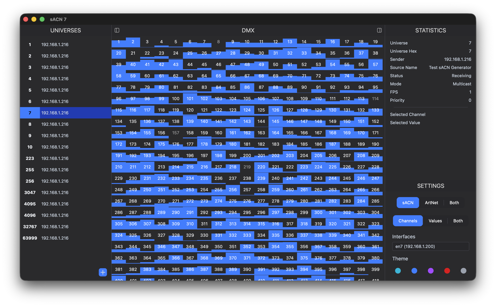

# sACN Monitor

> Monitor DMX data received over sACN (ANSI E1.31) or ArtNet in a clean, intuitive interface

<div align="center">
	
	
	

  
</div>

📖 [Full Documentation](https://sacn-monitor.bambinito.net)

---

## 🌟 Features

- **Real-time DMX Dashboard**: Monitor incoming sACN and ArtNet packets.
- **Channel View**: See individual DMX values across all 512 channels with color-coded intensity representation.
- **Universe Diagnostics**: FPS, Source Metadata, Reception Mode, and more.
- **Network Discovery**: Automatically detects and lists available sACN sources on your local network.
- **Network Selection**: Select the network interface to monitor on.
- **Themes**: Switch between 5 color themes.
- **Cross-Platform**: Native applications for macOS, Windows, and Linux.

---

## 🛠️ Built Upon

sACN Monitor is a modern desktop application built with:

- **[Wails](https://wails.io/)**: Cross-platform desktop framework with Go backend
- **[Mithril](https://mithril.js.org/)**: Lightweight and elegant JavaScript frontend framework
- **[TailwindCSS](https://tailwindcss.com/)**: Utility-first CSS framework for beautiful styling
- **[Flowbite](https://flowbite.com/)**: Modern component library for beautiful UI elements

---

## 📦 Installation

### Precompiled Binaries (Recommended)

Download ready-to-use binaries for macOS, Windows, and Linux from the [Releases page](https://gitlab.com/patopest/sacn-monitor/-/releases).

### Homebrew (macOS)

```bash
brew install patopesto/tap/sacn-monitor
```

### From source

```bash
git clone https://gitlab.com/patopest/sacn-monitor.git
cd sacn-monitor
wails build
```

---

## 🚀 Development


### Setup

1. Install `go` and `node` for your platform

2. Install Wails:

```bash
go install github.com/wailsapp/wails/v2/cmd/wails@latest
```
↗️ [Wails Getting Started guide](https://wails.io/docs/gettingstarted/installation)

### Run the App

Start the development build:

```bash
wails dev
```

The standalone app will launch. You can also access the frontend in your browser of choice on `http://localhost:34115` (or your configured Vite port).

### Build

Create distributable binaries:

```bash
wails build
```

For platform-specific builds:

```bash
# macOS
wails build -platform=darwin

# Windows
wails build -platform=windows

# Linux
wails build -platform=linux
```

---

## 📘 How It Works

sACN (Streaming ACN), also known as E1.31, is the industry standard for network-based DMX lighting control. This application decodes incoming sACN and ArtNet packets and displays the DMX data in a format familiar to lighting operators.

1. **Network Discovery**: Implements sACN Source Discovery and automatically registered for multicast reception for each advertised universes. If a source is not detected (not sending Discovery Packets), you can manually register universes to receive data for
2. **Packet Decoding**: Parses raw sACN packets according to the [ANSI E1.31 specification](https://tsp.esta.org/tsp/documents/docs/ANSI_E1-31-2018.pdf) and ArtNet packets according to the [ArtNet v4 specification](https://www.artisticlicence.com/WebSiteMaster/User%20Guides/art-net.pdf).
3. **Network Selection**: Resets received data and reconfigures reception on network interface change.

---

## 📚 References & Specifications

- [sACN (ANSI E1.31) Specification](https://tsp.esta.org/tsp/documents/docs/ANSI_E1-31-2018.pdf)
- [ArtNet v4 Specification](https://www.artisticlicence.com/WebSiteMaster/User%20Guides/art-net.pdf) © Artistic Licence Holding Ltd.
- [go-sacn](https://gitlab.com/patopest/go-sacn) - library used for sACN
- [go-artnet](https://github.com/jsimonetti/go-artnet) - library used for ArtNet
- [Haute Technique's ArtNetView](https://artnetview.com)
- [Open Lighting Architecture (OLA)](https://github.com/OpenLightingProject/ola) - Reference implementation of control protocols

---

## 🐛 Contributing

Contributions are welcome! Whether it's bug reports, feature requests, or code contributions:

1. Fork the repository
2. Create a feature branch
3. Commit your changes
4. Push to the branch
5. Open a Pull Request

---

## 📄 License

This project is licensed under MIT license. See the LICENSE file for details.

---

<div align="center">
  <strong>Made with ❤️ for lighting control enthusiasts</strong>
</div>
